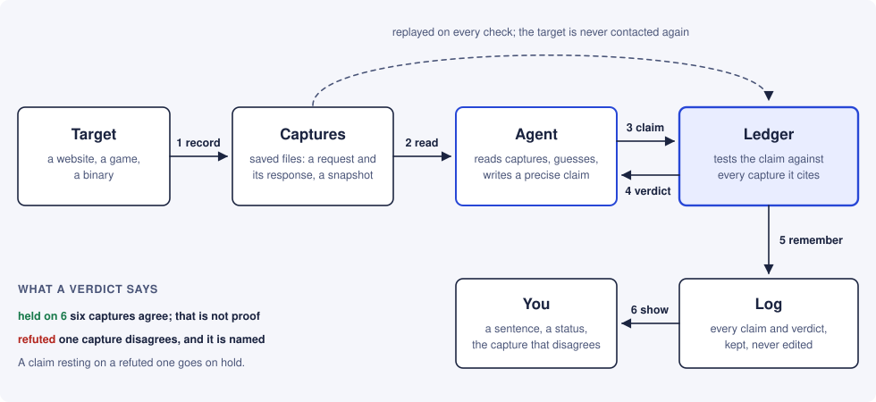

# re-suite

An agent-first reverse-engineering workbench. AI agents do the analysis; a person
approves what touches a live target and reviews the findings.

Its core is a **replay ledger**. An agent cannot record a finding as free text. It
files a typed claim, the ledger re-checks the claim offline against saved evidence
(captured web traffic, scripts, memory snapshots, what a tool recovered from a
program), and the person sees one plain sentence with a status, plus the case that
contradicts it when it fails. Checks never contact the target.

## Where it stands

| | |
| :- | :- |
| **Works today** | The ledger: thirteen claim kinds, an MCP server with five verbs, an append-only log, reruns on a new build of the target. Web claims on captured traffic. Every outside tool pinned. |
| **Being built** | Web reverse engineering end to end, as nine playbooks (below). This comes first. |
| **Paused (TODO)** | Binaries, file formats and live memory. What exists stays and is tested: call edges through Rizin, format claims, `ledger-capture`. |
| **After web works** | The read model for a person reviewing findings, then the desktop interface. |

`ROADMAP.md` has the plan, the rules that do not change, and a checkbox for each piece.

## How it works

The agent finds things. The ledger checks them against saved recordings of the
target and remembers the answer.



1. **Record.** The target is recorded once into capture files: a web request with
   its response, or a snapshot of memory.
2. **Read.** The agent reads the captures and forms a guess about how the target works.
3. **Claim.** The agent writes the guess as a precise statement and names the
   captures to test it on.
4. **Verdict.** The ledger replays the statement on each capture. It answers
   `held on N`, or `refuted` with the capture and field that disagree.
5. **Remember.** The claim and its verdict go into a log that is never edited.
6. **Show.** The human gets one sentence per finding, its status, and the failing
   case if there is one.

The ledger knows nothing about the target and cannot come up with a claim. The
agent can, but is often wrong without noticing. A real run on six captures of
crates.io:

```
claim    200 responses to `GET crates.io/api/v1/crates/{name}` have documentation: null
verdict  refuted by capture 70f35bf33291
         "https://docs.rs/regex" is not of type "null" at /crate/documentation

claim    the same, with documentation and homepage allowed to be a string or null
verdict  held on 6 captures
```

"Held on 6" means six captures did not contradict the claim. It is not proof.

## Web playbooks

A playbook is one situation an agent meets: what to run, on what, and which claims
the work ends in. The tools are existing ones, pinned, and run on saved evidence.
Only the first playbook touches the target, and only a person can start it.

| # | Playbook | Tools | Ends in |
| :- | :- | :- | :- |
| 1 | Capture a session. A person at a terminal approves the hosts | Chromium over the DevTools Protocol; mitmproxy for clients that are not browsers | a session: exchanges in order, the script and line that started each, every script's source |
| 2 | Fingerprint the stack: frameworks, servers, CDNs, bot walls, libraries | Wappalyzer rules on saved responses (`ledger-fingerprint`); retire.js | a `uses_technology` claim, and the choice of the next playbook. A bot wall stops the agent |
| 3 | Recover source from minified JavaScript | a captured source map; otherwise Wakaru, then webcrack for obfuscated code | readable modules as derived evidence |
| 4 | Find the API in the code | ast-grep | endpoints the scripts name that no capture shows |
| 5 | Map the API from traffic | the ledger | schema, status and header claims; an OpenAPI export of what holds |
| 6 | Trace a request to the code that sends it | the session, then playbook 3 | where an endpoint's requests start; signing keys as secret evidence |
| 7 | Sessions and login | the ordered session | flow claims: this token came from that response |
| 8 | GraphQL, WebSocket, WebAssembly | captures; wabt, wasm-tools | operation and frame claims |
| 9 | Compare two versions | a second session | what holds, moved or failed; which modules changed |

Each playbook is a file in `playbooks/web/`. An agent asks the server which ones apply
to what its ledger holds (`ask about=playbooks`) and gets the text of one by its id.
Only the first is written so far.

Three rules hold in every playbook. Static analysis comes first, and a new capture
is asked for only when saved evidence cannot answer. Recovered code and names are
the agent's reading until a claim about them holds. A tool's output is stored as
evidence, with the tool, its version and its inputs on record.

Most of this is not built yet. What is: the ledger, the web claim kinds, the pinned
tools, the runner that stores a tool's output as evidence, the browser half of
playbook 1 (`ledger-capture web`, and `session` evidence), and the server's list of
the playbooks that apply. What each tool did on
a real minified bundle is in `docs/trials/web-tools.md`.

## Claim kinds

A claim is one of thirteen typed statements. Each has an admission rule, a sentence, and a
checker that replays it on saved evidence.

| Kind | Says | Checked on |
| :- | :- | :- |
| `memory_layout` | a type is N bytes, with typed fields at fixed offsets | snapshots |
| `record_array` | a count is followed by that many fixed-size records | snapshots |
| `field_relation` | one integer equals a length or a sum taken from the rest | snapshots |
| `tagged_records` | a run of (size, tag, value) records | snapshots |
| `string_table` | a region holds a stated number of NUL-terminated strings | snapshots |
| `format` | every file parses under a Kaitai Struct description, which can place fields at offsets that counts decide | snapshots |
| `request_signature` | requests carry a MAC of stated parts, under a key kept as secret evidence | HTTP exchanges |
| `request_header` | requests carry a header whose value matches a schema | HTTP exchanges |
| `request_body_schema` | request bodies match a JSON Schema | HTTP exchanges |
| `response_schema` | responses with one status match a JSON Schema | HTTP exchanges |
| `response_header` | responses with one status carry a header whose value matches a schema | HTTP exchanges |
| `status_set` | an endpoint only answers with the listed statuses | HTTP exchanges |
| `call_edge` | one function calls another directly, within the code a tool recovered | what Rizin recovers from a program |

Toolchain: Rust 1.100.0 (pinned in `rust-toolchain.toml`), edition 2024, resolver 3.

## What has been measured

Each trial is a write-up with its numbers, its method and what it found wrong.

| Trial | Result |
| :- | :- |
| [Half-Life saves](docs/trials/half-life-saves.md) | 20 of 21 deliberately wrong claims caught |
| [Web traffic](docs/trials/web-api.md) | 19 of 19 caught |
| [Real websites](docs/trials/real-sites.md) | 14 of 15 caught; the one that held is true of the captures |
| [A staging site](docs/trials/staging-site.md) | 8 of 8 caught; the browser's cache had dropped a header from the capture |
| [A binary](docs/trials/crash-handler.md) | 3 of 3 caught |
| [With and without the ledger](docs/trials/ledger-loop.md) | no difference when the ledger holds only what the agent has read; 60 of 298 claims that held on 40 files failed on 6,554 held out |
| [Format claims](docs/trials/format-claims.md) | 10 of 10 caught; the ledger's count of contradicting files equals a count by hand |
| [Version reruns](docs/trials/version-rerun.md) | holds, moved and failed on a simulated pair of builds |
| [Rizin's recovery and lifting](docs/trials/rzil-coverage.md) | 96% to 98% of instructions lifted, 55% to 80% of functions in full |
| [The web tools](docs/trials/web-tools.md) | Wakaru split a 640 KB minified bundle into 105 modules in 2.5 s |

## Crates

| Crate | Purpose |
| :- | :- |
| `ledger-core` | Pure, synchronous model: claim kinds (one serde-tagged enum), content-hash IDs, `admit` → `WellFormed<Claim>`, events, verdicts, status derived from verdicts and premises. A verdict counts only while its checker is at the version the log last listed. A stored claim that today's admission rules refuse loads as withdrawn, so tightening a rule never makes a ledger unreadable. A `derived` event records each run of an outside tool: the tool, the version it reported, the evidence it read and the evidence it made. The ledger answers which run made a piece of evidence, and whether a run was made already. A `session` record keeps one browser session: the hosts the person approved and the ones that were blocked, every exchange in the order it was sent with the page it was for and the stack of script calls that sent it, and every script the pages parsed with its source map's address. The exchanges and the scripts' sources are evidence of their own, which the record names by id; it holds no clock time, so the same capture always has the same id. |
| `ledger-os` | Everything that differs by operating system, chosen at compile time behind one portable API: memory-mapped files, writing a file so that it is whole and on the disk before it is named, copying a file in under the name of its bytes, owner-only files and directories, a private temporary directory for a child process, a lock file, absolute paths other programs accept, the SQLite settings that make a commit durable, and reading the memory of a running process (Linux only so far; elsewhere it says so). Checked for Linux, Windows and macOS. |
| `ledger-store` | SQLite in WAL mode. One writer thread behind a bounded flume queue commits everything queued as one transaction, then publishes an immutable snapshot (state plus sequence number) that readers take without touching the writer. Append-only `events` table, `evidence` table indexing files named by content hash in `<ledger>.evidence/`, versioned schema. State is rebuilt by replaying events through ledger-core. One store holds a lock on a ledger file at a time; reading it needs none. Evidence files are copied in, never mapped from where an agent points, and the same bytes cannot be stored as two kinds. |
| `ledger-checkers` | Offline checkers behind one `Checker` trait, each with an id and a version: memory layout over snapshots (typed fields: fixed bytes, integer and float ranges, value sets, pointers, text, zero padding), signature replay and JSON Schema over captured HTTP exchanges (request line, status, headers, text or base64 bodies; an endpoint is `METHOD [host]/path` with optional query conditions; a capture of another endpoint or status is refused), and a reader that walks a Kaitai Struct description over a file without generating code, compared in a test with the Kaitai compiler's own parser. A check has a time limit and parsed evidence a size limit; exceeding either never yields "held". |
| `ledger-mcp` | MCP server over stdio with five tools: `propose`, `ask`, `explain`, `add_evidence`, `retract`. Input schemas come from ledger-core types via schemars. A check that was already made on the same claim, evidence and checker version is not run again. Two identical checks arriving together share one run. A claim that says less than an earlier refuted one is marked as weaker, with what it gave up. `add_evidence` takes single captures, a whole HAR file, a capture file of a browser session (stored as its exchanges, its scripts' sources as `artifact`, and the `session` record that names them; a file that is not a capture records nothing), a file as it is (`artifact`), or a tool and the ids of the evidence it reads. Outside programs are started in one place, the `runner` module, from a table with one entry per tool. A program is found only by the absolute path in its `LEDGER_TOOL_<ID>` variable, which the flake's shell sets, never on PATH. It runs with an empty environment and no input, on copies of its inputs in a private temporary directory that is also its working directory, with a time limit and one run at a time per tool. What it prints is stored as evidence and the run is logged, so the same tool at the same version on the same inputs runs once. A program given as `binary_facts` is stored as `artifact` evidence and Rizin reads it, in its own sandbox; the program is never run. `explain` says which run made a claim's evidence. At start the server writes its checkers and their versions to the log, then replays in the background every check an older checker version made, on the evidence that check read, so a fixed checker does not leave its claims unchecked. `ask` can list the captures of an endpoint, and the playbooks that apply to what the ledger holds, with the text of each. Responses are short, paged by key, use short ids and start with the sequence number they were computed at; rejections carry a stable code and a next step. The only crate with tokio; blocking work runs off the executor. |
| `ledger-cli` | `ledger-cli <file>` prints every claim with its status. With `--rerun-har` or `--rerun-snapshots` it re-checks the held claims against the captures of a new build and reports what holds, moved, failed or has no evidence, without recording anything. "Moved" is a suggestion: the claim holds at shifted offsets or under a renamed endpoint. A second program, `ledger-capture`, takes the captures only a person may take. `ledger-capture memory` reads memory from a running process and writes it with what the person saw on screen at that moment (`--seen hp=73`), as a file the server takes as `live_snapshot` evidence; a layout claim that names a seen value must then read as that value. `ledger-capture web --host <host>... <out> <address>...` starts Chromium from the absolute path in `LEDGER_TOOL_CHROMIUM`, with a new profile and the cache off, and drives it over the DevTools Protocol. A request to a host the person did not name is refused before it is sent and the host is listed as blocked; no other host name even resolves. It records the stack of script calls that sent each request and the source of every script, and writes a capture file for `session` evidence. Without `--headed` each address loads until the page settles; with it the person uses the browser and closes it to finish. Both run only for a person at a terminal, who types the process's name or the first host before anything is read or sent. |
| `ledger-bench` | `cargo run --release -p ledger-bench` reproduces the baseline table in ROADMAP.md and exits non-zero if a budget is broken. |

## Resolved dependency versions

From `cargo tree -p <crate> --depth 1`:

| Crate | Dependencies | Dev-dependencies |
| :- | :- | :- |
| `ledger-core` | blake3 1.8.7, hex 0.4.3, schemars 1.2.3, serde 1.0.229, serde_json 1.0.154, thiserror 2.0.21 | insta 1.49.0, pretty_assertions 1.4.1, proptest 1.12.0 |
| `ledger-os` | memmap2 0.9.12, tempfile 3.27.0 | |
| `ledger-store` | flume 0.12.0, jiff 1.0.3, ledger-core (path), ledger-os (path), rusqlite 0.43.0 (bundled), serde_json 1.0.154, thiserror 2.0.21, tracing 0.1.44 | proptest 1.12.0, tempfile 3.27.0 |
| `ledger-checkers` | base64 0.23.1, hex 0.4.3, hmac 0.13.0, jsonschema 0.63.1 (no default features), ledger-core (path), md-5 0.11.0, rayon 1.12.0, serde 1.0.229 (derive), serde_json 1.0.154, sha1 0.11.0, sha2 0.11.2, thiserror 2.0.21, tracing 0.1.44 | tempfile 3.27.0 |
| `ledger-mcp` | anyhow 1.0.105, ledger-checkers (path), ledger-core (path), ledger-os (path), ledger-store (path), rmcp 3.11.0 (server, macros, transport-io), schemars 1.2.3, tokio 1.54.1 (rt, macros, io-std, process, time, sync), tracing 0.1.44, tracing-subscriber 0.3.23 | insta 1.49.0, tempfile 3.27.0 |
| `ledger-cli` | anyhow 1.0.105, clap 4.6.10, ledger-checkers (path), ledger-core (path), ledger-os (path), ledger-store (path), serde 1.0.229 (derive), serde_json 1.0.154, tungstenite 0.30.0 | tempfile 3.27.0 |
| `ledger-bench` | ledger-core (path), ledger-store (path), rusqlite 0.43.0 (bundled) | tempfile 3.27.0 |

## Running

The only thing to install is [Nix](https://nixos.org/download) with flakes turned on. `flake.nix` and
`flake.lock` pin every tool: the Rust toolchain, the cargo tools CI uses, Rizin, the Kaitai Struct compiler,
gdb, uv, llvm, Node and Chromium, and the web tools: Wakaru, webcrack and retire.js (versions in
`tools/js/package-lock.json`), ast-grep, mitmproxy, prettier, wabt, wasm-tools, and `ledger-fingerprint`, the
Wappalyzer rule set on saved responses (`tools/fingerprint`). `uv.lock` pins the Python packages. Linux only so far.

```bash
nix develop                            # a shell with all of the tools; the commands below run inside it
cargo run -p ledger-mcp -- ledger.db   # MCP server on stdio
cargo run -p ledger-cli -- ledger.db   # list claims with status
cargo run -p ledger-cli --bin ledger-capture -- memory --pid 1234 --address 0x7ffd1000 --len 64 --seen hp=73 player.capture   # a live capture; asks you to confirm
cargo run -p ledger-cli --bin ledger-capture -- web --host shop.example shop.session https://shop.example/   # a browser session; asks you to confirm
uv run --locked docs/trials/lifter-compare.py <program>   # a trial script, with its Python packages
scripts/ci.sh                          # enters the shell itself: fmt, clippy (ledger-os also for Windows and macOS), nextest, doctests, deny, machete, uv lock
```
